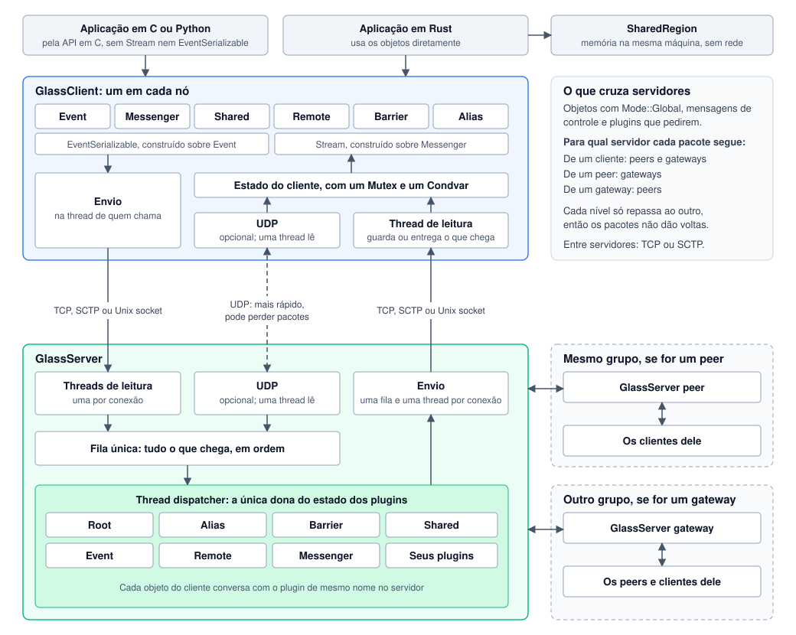

# libglass

Biblioteca de computação distribuída em Rust. Um `GlassServer` coordena vários
`GlassClient`s, que se comunicam por eventos, variáveis compartilhadas, barreiras e
outros objetos. Substitui o libGlass em C++, que não é mais desenvolvido.

```rust
use libglass::{Barrier, Event, GlassClient, GlassServer, Mode, EVERYBODY_ID};

let server = GlassServer::bind("127.0.0.1:9191")?;
let client = GlassClient::connect("127.0.0.1:9191", "node0")?;

let event = Event::<i32>::new(&client, "contador", Mode::Local)?;
event.enqueue(&42, EVERYBODY_ID, true)?;
let valor = event.try_get()?;

let barreira = Barrier::new(&client, 0, 0, true, Mode::Local)?;
barreira.sync()?;
```

## Visão geral

![Visão geral: um ambiente virtual 3D colaborativo roda sobre um motor gráfico com OpenGL, que usa a Glass em Rust, em C ou em Python. O arcabouço tem a instanciação (servidor-cliente, mestre-escravo, ponto-a-ponto com peers e gateways, e reconexão automática), os protocolos (TCP, UDP, SCTP, QUIC e Unix socket) e os plugins (eventos, barreiras, compartilhamento, aliases, variáveis remotas, mensagens, fluxos de dados, eventos serializáveis, memória compartilhada e plugins próprios). Em cinza, o que é novo na versão em Rust: a API em C, a reconexão automática e o QUIC.](docs/arquitetura-tese.svg)

A versão em Rust da arquitetura modularizada do libGlass original. Em cinza, o que não existia
na versão em C++.

## Arquitetura



Cada objeto do cliente conversa com o plugin de mesmo nome no servidor. Toda a lógica do
servidor roda em uma única thread, que processa um pacote de cada vez, então os plugins não
precisam de locks.

Essa thread não escreve nas conexões: cada uma tem uma fila e uma thread que escreve. Assim,
um cliente que lê devagar só atrasa os próprios pacotes. Se ele ficar 64 MiB para trás, ou
30 s sem conseguir receber nada, o servidor o desconecta.

Quando um cliente entra, ele recebe a lista de clientes, e os outros recebem só o novo
cliente; quando sai, os outros recebem só a saída. O custo de uma entrada não cresce com o
número de clientes.

## Objetos

| Tipo | Para que serve |
|---|---|
| `Event<T>` | Fila de mensagens entre clientes, para um nó ou para um grupo, com o remetente de cada uma |
| `Messenger<T>` | Mensagens ponto a ponto, em que quem recebe sabe quem enviou |
| `Shared<T>` | Variável com um valor comum, publicado e buscado explicitamente, em que a última atualização vence |
| `Remote<T>` | Variável própria de cada cliente, que os outros leem e alteram pelo id |
| `Barrier` | Ponto de sincronização, que pode ser desativado e reativado |
| `Alias<T>` | Valor local escolhido pelo nome que o grupo deu a este nó |
| `Stream` | Transferência de arquivos e outros dados grandes, em que quem envia fica no máximo 2 MiB à frente de quem recebe; os pedaços são numerados, e uma transferência que chega incompleta dá erro em vez de terminar |
| `EventSerializable` | Evento que carrega objetos de classes diferentes na mesma fila |
| `SharedRegion` | Memória compartilhada entre processos da mesma máquina, sem rede |

Valores trafegam pelo trait `Wire`. Números usam texto, `Raw<T>` usa os bytes nativos e
`Bytes` envia binário sem alterar. Com a feature `serde`, `Serde<T>` envia qualquer tipo
que implemente os traits do serde.

## Vários servidores

Peers formam um grupo: todos se conectam entre si, e os clientes de qualquer um deles
compartilham os objetos criados com `Mode::Global`. Gateways ligam grupos.

```rust
// Um grupo com dois peers. Basta conhecer um servidor do grupo.
let p1 = GlassServer::bind_peer("0.0.0.0:7001", None)?;
let p2 = GlassServer::bind_peer("0.0.0.0:8001", Some("host1:7001"))?;

// Dois grupos, ligados por seus gateways. Os peers entram pelo gateway.
let g1 = GlassServer::bind_remote_peer("0.0.0.0:7001", None)?;
let g2 = GlassServer::bind_remote_peer("0.0.0.0:7002", Some("host1:7001"))?;
let p = GlassServer::bind_peer("0.0.0.0:8002", Some("host2:7002"))?;
```

Os pacotes não dão voltas porque cada nível só repassa ao outro: o que vem de um cliente
vai para peers e gateways, o que vem de um peer vai só para outros grupos, e o que vem
de outro grupo vai só para os peers locais.

Cada servidor tem seus próprios clientes e seu próprio master. Um servidor que entra
depois recebe os objetos globais já existentes. Se o `seed` não responder, o servidor
começa um grupo novo. Um servidor só termina de entrar, e só então aceita clientes, depois que
todos os servidores do grupo o aceitam. Se algum já conhece outro servidor com o id que ele
sorteou, o que pode acontecer quando dois entram ao mesmo tempo por seeds diferentes, ele
recomeça com outro id.

## Transportes

- **TCP:** o padrão.
- **TCP + UDP:** com `bind_with_udp` e `connect_with_udp`, `Event::enqueue_unreliable` usa
  UDP, que é mais rápido para dados logo substituídos por outros mais novos, mas pode
  perder pacotes. O servidor informa a porta UDP ao cliente. Se UDP não funcionar, ou o
  dado não couber em um datagrama, tudo segue por TCP.
- **SCTP:** `bind_sctp`, `bind_peer_sctp`, `bind_remote_peer_sctp` e `connect_sctp`, fora do
  Windows. Veja abaixo.
- **QUIC:** `bind_quic`, `bind_peer_quic`, `bind_remote_peer_quic` e `connect_quic`, com a
  feature `quic`. Veja abaixo.
- **Unix sockets:** `bind_unix` e `connect_unix`, fora do Windows.

### SCTP

```rust
let p1 = GlassServer::bind_peer_sctp("0.0.0.0:7001", None)?;
let p2 = GlassServer::bind_peer_sctp("0.0.0.0:8001", Some("host1:7001"))?;
let client = GlassClient::connect_sctp("host1:7001", "node0")?;
```

Um servidor SCTP usa esse protocolo com os outros servidores e com os próprios clientes, e
todos os servidores de um grupo precisam usá-lo. Não é preciso instalar a `libsctp`, mas o
kernel precisa ter o módulo `sctp`, ou essas funções retornam erro. Elas não existem no Windows,
que não tem SCTP nativo.

- **Por que usar com peers:** com o servidor em `0.0.0.0`, o kernel pode usar várias interfaces
  de rede na mesma associação e trocar de caminho se uma cair. Esse failover não foi testado
  aqui.
- **O que não é usado:** os vários streams do SCTP. Tudo vai em um único stream ordenado, porque
  os objetos dependem da ordem dos pacotes.
- **Desempenho:** é mais lento que o TCP, principalmente em rajadas. Veja a comparação abaixo.
- **Em outras partes:** `connect_retry_sctp`; `glass_server_new_sctp`,
  `glass_server_new_peer_sctp` e `glass_client_connect_sctp` na API em C; `sctp=True` em
  Python; e `--sctp` no `render_wall`. O UDP continua só com TCP.

### QUIC

Fica atrás da feature `quic`, desligada por padrão, porque traz o
[quinn](https://github.com/quinn-rs/quinn), o rustls, o rcgen e o tokio:

```toml
libglass = { path = "...", features = ["quic"] }
```

```rust
use libglass::{GlassClient, GlassServer, QuicIdentity, QuicTrust};

// Um servidor sozinho gera um certificado autoassinado ao começar.
let server = GlassServer::bind_quic("0.0.0.0:7001")?;
let fingerprint = server.quic_fingerprint().unwrap(); // passar aos clientes
let client = GlassClient::connect_quic("host1:7001", "node0", QuicTrust::Fingerprint(fingerprint))?;

// Os servidores de um grupo usam o mesmo certificado.
let identity = QuicIdentity::generate()?;
let p1 = GlassServer::bind_peer_quic("0.0.0.0:7001", None, &identity)?;
let p2 = GlassServer::bind_peer_quic("0.0.0.0:8001", Some("host1:7001"), &identity)?;
```

Como no SCTP, um servidor QUIC usa esse protocolo com os outros servidores e com os próprios
clientes. Cada conexão leva um único stream bidirecional do QUIC, em ordem, como o TCP. A
biblioteca continua síncrona: um runtime do tokio, com duas threads próprias, roda o QUIC, e as
threads da biblioteca esperam por ele. Por isso, não use um cliente ou servidor QUIC de dentro de
um runtime do tokio, o que causa um panic.

**Segurança.** O QUIC sempre cifra a conexão, mas cifrar não basta: sem verificar o
certificado, quem estiver no meio do caminho pode se passar pelo servidor e ler ou alterar tudo.

- **Clientes:** `connect_quic` exige um `QuicTrust`. Com `QuicTrust::Fingerprint`, o cliente só
  aceita o certificado com esse SHA-256, e o servidor precisa provar que tem a chave privada dele.
  O fingerprint vem de `quic_fingerprint()` ou de `QuicIdentity::fingerprint()`, aparece como 64
  dígitos hexadecimais e é lido de texto com `parse()`. Ele precisa chegar ao cliente por um
  meio confiável. Com `QuicTrust::AnyCertificate`, o cliente aceita qualquer certificado: a
  conexão é cifrada, mas **não há proteção contra man in the middle**. Use só em uma rede
  confiável.
- **Servidores:** um grupo de peers, e os gateways ligados a ele, compartilham uma
  `QuicIdentity` (certificado e chave privada), e cada servidor só aceita esse certificado dos
  outros. Um peer com outro certificado não entra: ele começa um grupo novo, como quando o
  `seed` não responde. Para usar a mesma identidade em várias máquinas, salve
  `certificate_der()` e `private_key_der()` e carregue com `QuicIdentity::from_der`. Quem tiver
  a chave privada pode se passar por qualquer servidor do grupo.
- **O que não há:** o servidor não autentica os clientes, assim como no TCP. Não há autoridade
  certificadora, revogação nem troca de certificado sem reiniciar.

Outros pontos:

- **Desempenho:** entre dois contêineres da mesma máquina (Linux 6.6, WSL2), com 5 repetições
  de `compare_transports --remote ... --fingerprint ...`, na mesma execução que TCP, UDP e SCTP,
  mostrando a mediana:

  | Payload | Ida e volta (ms) TCP / QUIC | Rajada (MB/s) TCP / QUIC |
  |---|---|---|
  | 64 B | 0,145 / 0,360 | 14,5 / 13,1 |
  | 1 KiB | 0,134 / 0,362 | 197 / 125 |
  | 16 KiB | 0,173 / 0,617 | 1530 / 418 |
  | 60 KB | 0,195 / 0,846 | 2256 / 482 |
  | 1 MiB | 2,1 / 9,5 | 1734 / 535 |
  | 8 MiB | 49 / 102 | 460 / 334 |

  O QUIC não perdeu nem reordenou nada. Ele ficou atrás do TCP em todos os casos, com uma ida e
  volta de 2 a 4 vezes maior, mas à frente do SCTP a partir de 1 KiB (SCTP na mesma execução:
  55, 28, 276, 310 e 182 MB/s de 1 KiB a 8 MiB), e com bem menos variação entre repetições. Não
  foi medido de onde vem a diferença; o QUIC roda em espaço de usuário, com criptografia, e cada
  leitura e escrita passa para as threads do runtime. O número de threads do runtime e as
  janelas de fluxo (16 MiB) não foram ajustados por medição. Também aqui não há latência nem
  perda de verdade na rede, onde o controle de congestionamento do QUIC poderia se comportar de
  outro jeito.
- **Endereços que não respondem:** como é UDP, não há recusa imediata como no TCP; uma tentativa
  de conexão só desiste depois de 3 s. Se um nome resolver para vários endereços (por exemplo
  `localhost` para `::1` e `127.0.0.1`) e o servidor só ouvir em um deles, a conexão pode levar
  esse tempo a mais. Prefira o IP.
- **Reiniciar na mesma porta:** depois que um servidor QUIC para, a porta fica ocupada enquanto
  as conexões antigas terminam, o que levou de 100 a 150 ms nos testes. Com TCP, ela fica livre
  na hora.
- **Em outras partes:** `connect_retry_quic`. Ainda não há QUIC na API em C, no Python nem no
  `render_wall`.

### Comparação

O exemplo [compare_transports](examples/compare_transports.rs) mede os protocolos pela
própria biblioteca: dois clientes trocam um `Event`, passando pelo servidor. Ele falha se TCP ou
SCTP perderem, alterarem ou reordenarem alguma mensagem.

```
cargo run --release --example compare_transports
```

Para medir entre máquinas, rode `compare_transports -- serve` em uma e
`compare_transports -- --remote maquina1` em outra. Com `--features quic`, ele também mede o
QUIC: o `serve` mostra o fingerprint do certificado, para passar com `--fingerprint`.

Resultado com o servidor e os clientes em dois contêineres da mesma máquina, em Linux 6.6, com
5 repetições, mostrando a mediana:

| Payload | Ida e volta (ms) TCP / UDP / SCTP | Rajada (MB/s) TCP / UDP / SCTP | Perda do UDP na rajada |
|---|---|---|---|
| 64 B | 0,126 / 0,116 / 0,134 | 15 / 11 / 0,5 | 18,5% |
| 1 KiB | 0,132 / 0,130 / 0,148 | 202 / 166 / 60 | 3,3% |
| 16 KiB | 0,155 / 0,190 / 0,428 | 1741 / 674 / 247 | 4,8% |
| 60 KB | 0,230 / 0,381 / 0,877 | 1277 / 287 / 300 | 61,4% |
| 1 MiB | 5,1 / não cabe / 16,8 | 752 / não cabe / 25 | - |
| 8 MiB | 50 / não cabe / 152 | 424 / não cabe / 176 | - |

- **TCP** foi o mais rápido ou empatou em quase todos os casos, sem perder nada.
- **UDP** só teve ida e volta melhor que o TCP nos payloads pequenos, e por pouco. Na rajada, ele
  perde o que o outro lado não consegue absorver, porque não tem controle de fluxo. Na troca de
  uma mensagem por vez, não houve perda.
- **SCTP** não perdeu nada, mas teve a menor vazão em quase todos os casos, e variou muito entre
  repetições: em 16 KiB, de 13 a 262 MB/s. No mesmo processo, ficou pior: 3,3 MB/s em 1 KiB e
  6,1 MB/s em 60 KB.

Aumentar os buffers do socket ou confirmar cada pacote (`SCTP_DELAYED_SACK`) não melhorou a
vazão do SCTP, e em alguns tamanhos piorou.

Esses números não incluem uma rede de verdade: não há latência nem perda entre os contêineres, e
nessas condições não aparece nenhuma vantagem do SCTP, como trocar de caminho quando uma rede cai.

## Estender

Plugins próprios implementam `ServerPlugin` no servidor (`GlassServer::add_plugin`, com
ids acima de `MAX_RESERVED_PLUGIN_ID`). No cliente, usam `send_to_plugin` e
`set_plugin_handler`.

## Outras linguagens

[include/libglass.h](include/libglass.h) define a API em C. A biblioteca compilada por
`cargo build` já a exporta, e [bindings/python](bindings/python) a usa pelo `ctypes`:

```python
import libglass

with libglass.Server() as server, libglass.Client(server.address, "a") as client:
    with libglass.Event(client, "ev") as event:
        event.enqueue(b"oi", send_to_self=True)
        print(event.get())
```

## Testes e exemplo

```
cargo test --features serde
cargo test --features serde,quic              # também os testes de QUIC
python bindings/python/test_libglass.py       # depois de cargo build
cargo run --example quicksort -- 100000 4
```

Os testes de Unix sockets não rodam no Windows, e os de SCTP são pulados onde ele não existe.
Para rodar tudo em Linux, em um contêiner descartável:

```
docker run --rm -v "${PWD}:/src:ro" rust:1 sh /src/scripts/test-linux.sh
```

Para rodar o mesmo em Ubuntu 24.04, que instala o Rust no contêiner antes, troque a imagem e
passe o script para [scripts/ubuntu.sh](scripts/ubuntu.sh). Isso também vale para o teste de
ponta a ponta do `render_wall`, mais abaixo:

```
docker run --rm -v "${PWD}:/src:ro" ubuntu:24.04 sh /src/scripts/ubuntu.sh scripts/test-linux.sh
```

**No Windows**, `cargo build` compila a biblioteca em qualquer toolchain, mas `cargo test` e
os exemplos também compilam as dependências de janela do `render_wall`, que precisam de um
destes:

- Toolchain MSVC, o padrão do Rust, com o componente C++ do Visual Studio.
- Toolchain GNU com o MinGW completo no `PATH`, porque o `dlltool` que vem com o Rust depende
  do `as`.

## Renderização distribuída

O exemplo [render_wall](examples/render_wall) é uma parede de tiles com OpenGL 3.3: cada
janela mostra um pedaço de uma única cena animada, e todas trocam de quadro juntas.

```
cargo run --example render_wall -- demo 4
```

Em várias máquinas, com um servidor e quantos nós quiser:

```
maquina1$ cargo run --example render_wall -- server 0.0.0.0:9191 --wait-for 2
maquina2$ cargo run --example render_wall -- node maquina1:9191
maquina3$ cargo run --example render_wall -- node maquina1:9191
```

| Comando, em qualquer janela | Efeito, em todas |
|---|---|
| Setas, WASD ou arrastar com o mouse | Translação |
| `+`, `-` ou roda do mouse | Escala |
| Espaço | Pausa ou retoma a animação |
| `T` | Mostra ou esconde as bordas dos tiles |
| `R` | Volta à vista inicial |
| Esc | Fecha a parede inteira |

Para ver a sincronização: a barra amarela e a barra azul atravessam os tiles, e o quadro
atual aparece em binário na parte de baixo. Se os nós mostrassem quadros diferentes, tudo
isso quebraria onde dois tiles se encontram.

**Como funciona.** Um coordenador sem janela, que roda junto do servidor, decide cada
quadro. O `Event` leva o estado do quadro a todos, o `Messenger` leva os comandos de
teclado e mouse ao coordenador, e o `Barrier` segura a troca de buffer até todos terminarem
de renderizar. Como só o coordenador calcula o estado, os nós não têm como divergir.
Veja [sync.rs](examples/render_wall/sync.rs).

- Um nó pode entrar ou cair a qualquer momento, e a tela é redividida entre os restantes.
- O nó mais lento dita a velocidade de todos. Para simular isso, use `--delay-ms`.
- Um nó travado, mas ainda conectado, para a parede inteira, porque ela usa `Barrier::sync`,
  que espera sem prazo. `Barrier::sync_timeout` desiste depois de um prazo, e o cliente
  continua contando como chegado: a próxima chamada espera a mesma liberação.
- Para testar com carga, use `--cubes`. As demais opções aparecem ao rodar sem argumentos.

**Teste de ponta a ponta.** Abre janelas de verdade e verifica se os tiles juntos formam a
mesma imagem de uma janela única, se os nós trocam de quadro juntos, e se a parede sobrevive
a um nó lento, a um nó atrasado e a um nó morto:

```
cargo build --example render_wall
python tests/render_wall/test_render_wall.py
```

As imagens e os logs de cada rodada ficam em `tests/render_wall/output`, fora do Git. Com
`xdotool` instalado, em X11, o teste também aperta teclas e usa o mouse de verdade. Para rodar
tudo isso em Linux, em um contêiner descartável com tela virtual:

```
docker run --rm -v "${PWD}:/src:ro" -v "${PWD}/tests/render_wall/output:/out" rust:1 sh /src/tests/render_wall/run-linux.sh
```

## Limitações

- Conectar desiste depois de 10 s, para clientes e para servidores que entram num grupo. O
  prazo é do processo inteiro e muda com `set_connect_timeout` (`glass_set_connect_timeout` em
  C, `libglass.set_connect_timeout` em Python). Com 3 s, como antes, uma rede com 1% de perda
  impedia o SCTP de conectar, porque ele só repete o início da conexão depois de 3 s.

- Quando a ligação entre dois servidores cai sem que eles tenham saído, o de menor id tenta
  refazê-la por até 30 s. O que foi enviado enquanto ela estava fora se perde.
- Um cliente só se reconecta sozinho se pedir, com `set_reconnect`. Ele recupera o id se o
  servidor ainda o tiver livre, o que inclui um servidor reiniciado no mesmo endereço, desde
  que não seja um peer, cujo id é sorteado. O que foi enviado enquanto ele estava fora e o
  que só o servidor guardava, como associações de `Alias`, se perdem, e o UDP não volta.
- Em `Shared`, duas atualizações feitas ao mesmo tempo em servidores diferentes não se
  misturam: uma delas se perde, e fica a do cliente de id menor.

## O que não veio do C++

| Parte | Motivo |
|---|---|
| UDP puro | No C++ não está no build e não compila. Sem entrega garantida, os outros objetos também não funcionariam nele |
| Demos com OpenGL | Dependem de GLUT e não foram portados um a um. O `render_wall` faz a divisão em tiles de `tiledrendering`, mas as vistas de CAVE e o estéreo de `cubes` não vieram |
| Bindings Java e SWIG | Dependem da API em C++. A API em C é a base para refazê-los, e não há JDK nos ambientes de teste usados |
| `geditor`, `gtracer` | Ferramentas em Java que geram código para a API em C++ e leem logs dela |
| `dissociate`, `lowpeer`, `sendUpdateAll` | No C++ não têm implementação ou uso, e o novo roteamento dispensa `lowpeer` |
| Formato do Boost Serialization | `Serde<T>` faz esse papel, em outro formato |

O formato de rede segue o do C++ em boa parte, mas a compatibilidade com ele não é um
objetivo e nunca foi testada contra um binário real.

## O que mudou em relação ao C++

**API e arquitetura**

- Os objetos recebem o cliente explicitamente, em vez do "Glass atual" global.
- Erros são `Result`, em vez de exceções e códigos de retorno.
- `kill_all` para os servidores e desconecta os clientes, sem encerrar o processo.
- Uma thread por conexão lê pacotes e uma única thread os processa no servidor, dona do
  estado dos plugins. Isso substitui o `select()`, limitado a `FD_SETSIZE` conexões, e os
  mutexes recursivos.

**O que não funcionava e agora funciona**

Vem da leitura do código, sem execução do original.

- Barreira global, que no C++ não sincronizava entre servidores.
- Objetos criados antes de um peer conectar, que nunca chegavam a ele.
- Resolução de conflito de ids entre peers.
- `Remote::get_value` e as cópias entre nós, que eram `TODO` ou estavam desativadas.
- `Messenger` e `Stream`, que no C++ estão fora do build, e `EventSerializable`, cuja
  leitura pulava o primeiro caractere do nome.
- `Barrier::disable` e `enable`, `Alias::delete_alias` e associações para todos.
- `Shared::get_update`, que agora espera a resposta do servidor.

**Erros de segurança que não vieram**

- Tamanhos vindos da rede não eram validados em `tcp.cpp`, o que permitia leituras e
  escritas fora do buffer.
- Qualquer cliente podia se passar por outro pelo campo `from`. Aqui, o remetente é
  determinado pela conexão, e UDP exige um token enviado antes por TCP.

## Licença

LGPL 2 ou posterior, como o libGlass original, de Bruno Barberi Gnecco e Corollarium
Technologies. Veja [COPYING](COPYING).
