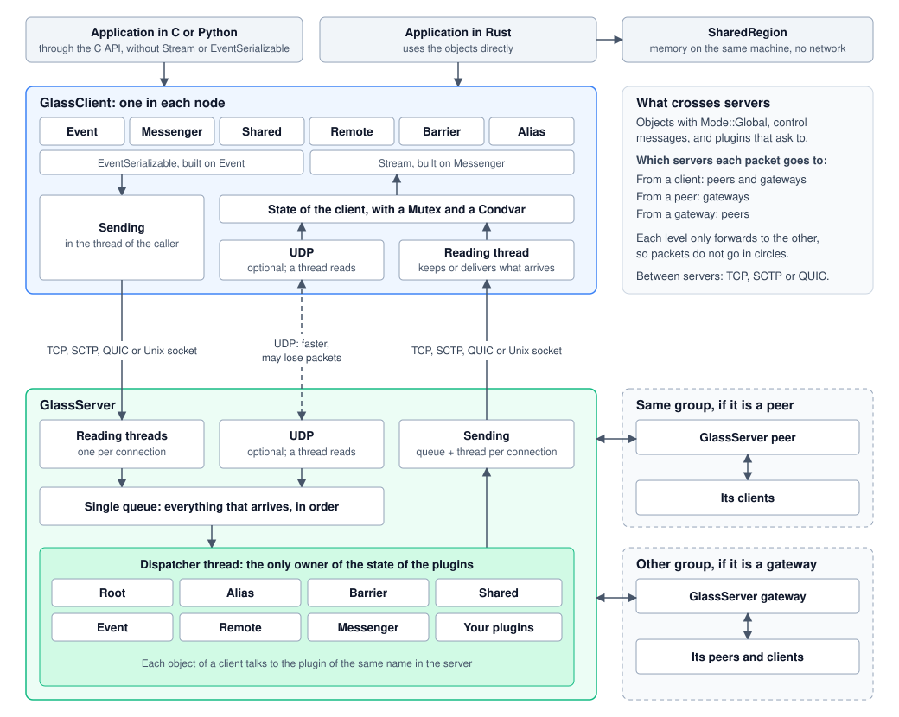

# libglass

A distributed computing library in Rust. A `GlassServer` coordinates several
`GlassClient`s, which communicate through events, shared variables, barriers and other
objects. It replaces the C++ libGlass, which is no longer developed.

```rust
use libglass::{Barrier, Event, GlassClient, GlassServer, Mode, EVERYBODY_ID};

let server = GlassServer::bind("127.0.0.1:9191")?;
let client = GlassClient::connect("127.0.0.1:9191", "node0")?;

let event = Event::<i32>::new(&client, "counter", Mode::Local)?;
event.enqueue(&42, EVERYBODY_ID, true)?;
let value = event.try_get()?;

let barrier = Barrier::new(&client, 0, 0, true, Mode::Local)?;
barrier.sync()?;
```

## Overview

![Overview: a collaborative 3D virtual environment runs on a graphics engine with OpenGL, which uses Glass from Rust, C or Python. The framework has the instantiation (client-server, master-slave, peer-to-peer with peers and gateways, and automatic reconnection), the protocols (TCP, UDP, SCTP, QUIC and Unix sockets) and the plugins (events, barriers, sharing, aliases, remote variables, messages, data streams, serializable events, shared memory and custom plugins). In grey, what is new in the Rust version: the C API, automatic reconnection and QUIC.](docs/overview.svg)

The Rust version of the modular architecture of the original libGlass. In grey, what did not
exist in the C++ version.

## Architecture



Each object of a client talks to the plugin of the same name in the server. All the logic of
the server runs in a single thread, which processes one packet at a time, so plugins need no
locks.

That thread does not write to the connections: each one has a queue and a thread that writes
it. So a client that reads slowly only delays its own packets. If it falls 64 MiB behind, or
cannot take anything for 30 s, the server disconnects it.

When a client joins, it gets the list of clients, and the others get only the new client;
when it leaves, the others get only the departure. The cost of a join does not grow with the
number of clients.

## Objects

| Type | Purpose |
|---|---|
| `Event<T>` | Message queue between clients, for one node or a group, with the sender of each message |
| `Messenger<T>` | Point-to-point messages, where the receiver knows who sent them |
| `Shared<T>` | Variable with a common value, published and fetched explicitly, where the last update wins |
| `Remote<T>` | Variable of each client, which the others read and change by id |
| `Barrier` | Synchronization point, which can be disabled and enabled again |
| `Alias<T>` | Local value chosen by the name that the group gave to this node |
| `Stream` | Transfer of files and other large data, where the sender stays at most 2 MiB ahead of the receiver; pieces are numbered, and a transfer that arrives incomplete gives an error instead of finishing |
| `EventSerializable` | Event that carries objects of different classes in the same queue |
| `SharedRegion` | Memory shared between processes on the same machine, without the network |

Values travel through the `Wire` trait. Numbers use text, `Raw<T>` uses the native bytes and
`Bytes` sends binary data unchanged. With the `serde` feature, `Serde<T>` sends any type that
implements the serde traits.

## Several servers

Peers form a group: they all connect to each other, and the clients of any of them share the
objects created with `Mode::Global`. Gateways link groups.

```rust
// A group with two peers. Knowing one server of the group is enough.
let p1 = GlassServer::bind_peer("0.0.0.0:7001", None)?;
let p2 = GlassServer::bind_peer("0.0.0.0:8001", Some("host1:7001"))?;

// Two groups, linked by their gateways. The peers join through the gateway.
let g1 = GlassServer::bind_remote_peer("0.0.0.0:7001", None)?;
let g2 = GlassServer::bind_remote_peer("0.0.0.0:7002", Some("host1:7001"))?;
let p = GlassServer::bind_peer("0.0.0.0:8002", Some("host2:7002"))?;
```

Packets do not go around in circles because each level only forwards to the other: what
comes from a client goes to peers and gateways, what comes from a peer goes only to other
groups, and what comes from another group goes only to the local peers.

Each server has its own clients and its own master. A server that joins later receives the
global objects that already exist. If the `seed` does not answer, the server starts a new
group. A server only finishes joining, and only then accepts clients, after every server of
the group has accepted it. If one of them already knows another server with the id that it
drew, which can happen when two join at the same time through different seeds, it starts over
with another id.

## Transports

- **TCP:** the default.
- **TCP + UDP:** with `bind_with_udp` and `connect_with_udp`, `Event::enqueue_unreliable` uses
  UDP, which is faster for data that is soon replaced by newer data, but can lose packets.
  The server tells the client its UDP port. If UDP does not work, or the data does not fit in
  a datagram, everything goes through TCP.
- **SCTP:** `bind_sctp`, `bind_peer_sctp`, `bind_remote_peer_sctp` and `connect_sctp`, outside
  Windows. See below.
- **QUIC:** `bind_quic`, `bind_peer_quic`, `bind_remote_peer_quic` and `connect_quic`, with the
  `quic` feature. See below.
- **Unix sockets:** `bind_unix` and `connect_unix`, outside Windows.

### SCTP

```rust
let p1 = GlassServer::bind_peer_sctp("0.0.0.0:7001", None)?;
let p2 = GlassServer::bind_peer_sctp("0.0.0.0:8001", Some("host1:7001"))?;
let client = GlassClient::connect_sctp("host1:7001", "node0")?;
```

An SCTP server uses this protocol with the other servers and with its own clients, and every
server of a group must use it. There is no need to install `libsctp`, but the kernel must have
the `sctp` module, or these functions return an error. They do not exist on Windows, which has
no native SCTP.

- **Why use it with peers:** with the server on `0.0.0.0`, the kernel can use several network
  interfaces in the same association and switch paths if one fails. This failover was not
  tested here.
- **What is not used:** the multiple streams of SCTP. Everything goes in a single ordered
  stream, because the objects depend on the order of the packets.
- **Performance:** it is slower than TCP, especially in bursts. See the comparison below.
- **Elsewhere:** `connect_retry_sctp`; `glass_server_new_sctp`, `glass_server_new_peer_sctp` and
  `glass_client_connect_sctp` in the C API; `sctp=True` in Python; and `--sctp` in
  `render_wall`. UDP still only works with TCP.

### QUIC

It is behind the `quic` feature, off by default, because it brings in
[quinn](https://github.com/quinn-rs/quinn), rustls, rcgen and tokio:

```toml
libglass = { path = "...", features = ["quic"] }
```

```rust
use libglass::{GlassClient, GlassServer, QuicIdentity, QuicTrust};

// A standalone server generates a self-signed certificate when it starts.
let server = GlassServer::bind_quic("0.0.0.0:7001")?;
let fingerprint = server.quic_fingerprint().unwrap(); // to give to the clients
let client = GlassClient::connect_quic("host1:7001", "node0", QuicTrust::Fingerprint(fingerprint))?;

// The servers of a group use the same certificate.
let identity = QuicIdentity::generate()?;
let p1 = GlassServer::bind_peer_quic("0.0.0.0:7001", None, &identity)?;
let p2 = GlassServer::bind_peer_quic("0.0.0.0:8001", Some("host1:7001"), &identity)?;
```

As with SCTP, a QUIC server uses this protocol with the other servers and with its own
clients. Each connection carries a single bidirectional QUIC stream, in order, like TCP. The
library is still synchronous: a tokio runtime, with two threads of its own, runs QUIC, and the
threads of the library wait for it. Therefore, do not use a QUIC client or server from inside a
tokio runtime, which causes a panic.

**Security.** QUIC always encrypts the connection, but encryption is not enough: without
checking the certificate, anyone in the middle of the path can pose as the server and read or
change everything.

- **Clients:** `connect_quic` requires a `QuicTrust`. With `QuicTrust::Fingerprint`, the client
  only accepts the certificate with that SHA-256, and the server must prove that it has its
  private key. The fingerprint comes from `quic_fingerprint()` or from
  `QuicIdentity::fingerprint()`, shows as 64 hexadecimal digits and is read from text with
  `parse()`. It must reach the client through a trusted channel. With
  `QuicTrust::AnyCertificate`, the client accepts any certificate: the connection is encrypted,
  but **there is no protection against a man in the middle**. Use it only on a trusted network.
- **Servers:** a group of peers, and the gateways linked to it, share a `QuicIdentity`
  (certificate and private key), and each server only accepts that certificate from the others.
  A peer with another certificate does not join: it starts a new group, as when the `seed` does
  not answer. To use the same identity on several machines, save `certificate_der()` and
  `private_key_der()` and load them with `QuicIdentity::from_der`. Anyone with the private key
  can pose as any server of the group.
- **What there is not:** the server does not authenticate clients, as with TCP. There is no
  certificate authority, revocation or certificate change without a restart.

Other points:

- **Performance:** between two containers on the same machine (Linux 6.6, WSL2), with 5 runs
  of `compare_transports --remote ... --fingerprint ...`, in the same execution as TCP, UDP and
  SCTP, showing the median:

  | Payload | Round trip (ms) TCP / QUIC | Burst (MB/s) TCP / QUIC |
  |---|---|---|
  | 64 B | 0.145 / 0.360 | 14.5 / 13.1 |
  | 1 KiB | 0.134 / 0.362 | 197 / 125 |
  | 16 KiB | 0.173 / 0.617 | 1530 / 418 |
  | 60 KB | 0.195 / 0.846 | 2256 / 482 |
  | 1 MiB | 2.1 / 9.5 | 1734 / 535 |
  | 8 MiB | 49 / 102 | 460 / 334 |

  QUIC lost and reordered nothing. It was behind TCP in every case, with a round trip 2 to 4
  times longer, but ahead of SCTP from 1 KiB up (SCTP in the same execution: 55, 28, 276, 310
  and 182 MB/s from 1 KiB to 8 MiB), and with much less variation between runs. Where the
  difference comes from was not measured; QUIC runs in user space, with encryption, and each
  read and write goes through the threads of the runtime. The number of runtime threads and
  the flow-control windows (16 MiB) were not tuned by measurement. Here too there is no real
  latency or loss on the network, where the congestion control of QUIC could behave
  differently.
- **Addresses that do not answer:** as it is UDP, there is no immediate refusal as with TCP; a
  connection attempt only gives up after the connect timeout (10 s by default, see
  `set_connect_timeout`). If a name resolves to several addresses (for example `localhost` to
  `::1` and `127.0.0.1`) and the server only listens on one of them, connecting can take that
  much longer. Prefer the IP address.
- **Restarting on the same port:** after a QUIC server stops, the port stays busy while the old
  connections wind down, which took 100 to 150 ms in the tests. With TCP, it is free at once.
- **Elsewhere:** `connect_retry_quic` and `--quic` in `render_wall`. There is no QUIC in the C
  API or in Python yet.

### Comparison

The [compare_transports](examples/compare_transports.rs) example measures the protocols
through the library itself: two clients exchange an `Event`, through the server. It fails if
TCP or SCTP lose, change or reorder any message.

```
cargo run --release --example compare_transports
```

To measure between machines, run `compare_transports -- serve` on one and
`compare_transports -- --remote machine1` on another. With `--features quic`, it also measures
QUIC: `serve` shows the fingerprint of the certificate, to pass with `--fingerprint`.

Results with the server and the clients in two containers on the same machine, on Linux 6.6,
with 5 runs, showing the median:

| Payload | Round trip (ms) TCP / UDP / SCTP | Burst (MB/s) TCP / UDP / SCTP | UDP loss in the burst |
|---|---|---|---|
| 64 B | 0.126 / 0.116 / 0.134 | 15 / 11 / 0.5 | 18.5% |
| 1 KiB | 0.132 / 0.130 / 0.148 | 202 / 166 / 60 | 3.3% |
| 16 KiB | 0.155 / 0.190 / 0.428 | 1741 / 674 / 247 | 4.8% |
| 60 KB | 0.230 / 0.381 / 0.877 | 1277 / 287 / 300 | 61.4% |
| 1 MiB | 5.1 / does not fit / 16.8 | 752 / does not fit / 25 | - |
| 8 MiB | 50 / does not fit / 152 | 424 / does not fit / 176 | - |

- **TCP** was the fastest, or tied, in almost every case, and lost nothing.
- **UDP** only had a better round trip than TCP for small payloads, and barely. In bursts, it
  loses what the other side cannot absorb, because it has no flow control. When exchanging one
  message at a time, nothing was lost.
- **SCTP** lost nothing, but had the lowest throughput in almost every case, and varied a lot
  between runs: at 16 KiB, from 13 to 262 MB/s. In the same process, it was worse: 3.3 MB/s at
  1 KiB and 6.1 MB/s at 60 KB.

Larger socket buffers, or acknowledging every packet (`SCTP_DELAYED_SACK`), did not improve
the throughput of SCTP, and made it worse for some sizes.

These numbers do not include a real network: there is no latency or loss between the
containers, and under these conditions no advantage of SCTP shows up, such as switching paths
when a network fails.

## Extending

Custom plugins implement `ServerPlugin` in the server (`GlassServer::add_plugin`, with ids
above `MAX_RESERVED_PLUGIN_ID`). In the client, they use `send_to_plugin` and
`set_plugin_handler`.

## Other languages

[include/libglass.h](include/libglass.h) defines the C API. The library built by
`cargo build` already exports it, and [bindings/python](bindings/python) uses it through
`ctypes`:

```python
import libglass

with libglass.Server() as server, libglass.Client(server.address, "a") as client:
    with libglass.Event(client, "ev") as event:
        event.enqueue(b"hi", send_to_self=True)
        print(event.get())
```

## Tests and example

```
cargo test --features serde
cargo test --features serde,quic              # also the QUIC tests
python bindings/python/test_libglass.py       # after cargo build
cargo run --example quicksort -- 100000 4
```

The Unix socket tests do not run on Windows, and the SCTP tests are skipped where it does not
exist. To run everything on Linux, in a throwaway container:

```
docker run --rm -v "${PWD}:/src:ro" rust:1 sh /src/scripts/test-linux.sh
```

To run the same on Ubuntu 24.04, which installs Rust in the container first, change the image
and pass the script to [scripts/ubuntu.sh](scripts/ubuntu.sh). This also works for the
end-to-end test of `render_wall`, further below:

```
docker run --rm -v "${PWD}:/src:ro" ubuntu:24.04 sh /src/scripts/ubuntu.sh scripts/test-linux.sh
```

**On Windows**, `cargo build` builds the library with any toolchain, but `cargo test` and the
examples also build the window dependencies of `render_wall`, which need one of these:

- The MSVC toolchain, the Rust default, with the C++ component of Visual Studio.
- The GNU toolchain with the full MinGW on the `PATH`, because the `dlltool` that comes with
  Rust depends on `as`.

## Distributed rendering

The [render_wall](examples/render_wall) example is a wall of tiles with OpenGL 3.3: each
window shows a piece of a single animated scene, and they all change frames together.

```
cargo run --example render_wall -- demo 4
```

On several machines, with a server and as many nodes as you want:

```
machine1$ cargo run --example render_wall -- server 0.0.0.0:9191 --wait-for 2
machine2$ cargo run --example render_wall -- node machine1:9191
machine3$ cargo run --example render_wall -- node machine1:9191
```

With `--sctp` on the server and on each node, everything goes through SCTP. For QUIC, build
with `--features quic` and use `--quic`: the server shows `node options: --quic --fingerprint ...`,
which the nodes take so that they only accept its certificate. `--any-certificate` instead of
`--fingerprint` accepts any certificate, with no protection against a man in the middle.

| Command, in any window | Effect, in all of them |
|---|---|
| Arrows, WASD or dragging with the mouse | Translation |
| `+`, `-` or the mouse wheel | Scale |
| Space | Pauses or resumes the animation |
| `T` | Shows or hides the borders of the tiles |
| `R` | Goes back to the initial view |
| Esc | Closes the whole wall |

To see the synchronization: the yellow bar and the blue bar cross the tiles, and the current
frame appears in binary at the bottom. If the nodes showed different frames, all of this would
break where two tiles meet.

**How it works.** A windowless coordinator, which runs alongside the server, decides each
frame. The `Event` carries the state of the frame to everyone, the `Messenger` carries the
keyboard and mouse commands to the coordinator, and the `Barrier` holds the buffer swap until
everyone has finished rendering. As only the coordinator computes the state, the nodes cannot
diverge. See [sync.rs](examples/render_wall/sync.rs).

- A node can join or drop out at any time, and the screen is divided again among the rest.
- The slowest node sets the pace for all. To simulate it, use `--delay-ms`.
- A node that is stuck, but still connected, stops the whole wall, because the wall uses
  `Barrier::sync`, which waits with no time limit. `Barrier::sync_timeout` gives up after a
  timeout, and the client still counts as arrived: the next call waits for the same release.
- To test under load, use `--cubes`. The other options show up when it is run without
  arguments.

**End-to-end test.** It opens real windows and checks that the tiles together form the same
image as a single window, that the nodes change frames together, and that the wall survives a
slow node, a late node and a dead node:

```
cargo build --example render_wall
python tests/render_wall/test_render_wall.py
```

The images and logs of each run are left in `tests/render_wall/output`, outside Git. With
`xdotool` installed, on X11, the test also presses keys and uses the mouse for real. To run all
of this on Linux, in a throwaway container with a virtual screen:

```
docker run --rm -v "${PWD}:/src:ro" -v "${PWD}/tests/render_wall/output:/out" rust:1 sh /src/tests/render_wall/run-linux.sh
```

**Test in containers.** It puts the server and each node in a container of its own, with a
virtual screen, linked only by a Docker network, and checks the image of the tiles, the
simultaneous swap, a slow node, a node that joins and another that dies, a frozen node
(`docker pause`) and a network with delay and jitter. The containers use the clock of the
machine, so the time differences measured between them are real:

```
docker build -f tests/render_wall/Dockerfile -t libglass-render-wall .
python tests/render_wall/test_containers.py
```

## Limitations

- Connecting gives up after 10 s, for clients and for servers that join a group. The timeout
  applies to the whole process and is changed with `set_connect_timeout`
  (`glass_set_connect_timeout` in C, `libglass.set_connect_timeout` in Python). With 3 s, as
  before, a network with 1% loss kept SCTP from connecting, because it only repeats the start
  of the connection after 3 s.
- When the link between two servers drops without either of them having left, the one with the
  lower id tries to restore it for up to 30 s. What was sent while it was down is lost.
- A client only reconnects by itself if it asks to, with `set_reconnect`. It gets its id back
  if the server still has it free, which includes a server restarted at the same address,
  unless it is a peer, whose id is drawn at random. What was sent while it was away and what
  only the server kept, such as `Alias` associations, are lost, and UDP does not come back.
- In `Shared`, two updates made at the same time on different servers are not merged: one of
  them is lost, and the one from the client with the lower id is kept.

## What did not come from C++

| Part | Reason |
|---|---|
| Plain UDP | In C++ it is not in the build and does not compile. Without guaranteed delivery, the other objects would not work on it either |
| OpenGL demos | They depend on GLUT and were not ported one by one. `render_wall` does the tile split of `tiledrendering`, but the CAVE views and the stereo of `cubes` did not come |
| Java and SWIG bindings | They depend on the C++ API. The C API is the basis for redoing them, and there is no JDK in the test environments used |
| `geditor`, `gtracer` | Java tools that generate code for the C++ API and read its logs |
| `dissociate`, `lowpeer`, `sendUpdateAll` | In C++ they have no implementation or use, and the new routing makes `lowpeer` unnecessary |
| Boost Serialization format | `Serde<T>` plays this role, in another format |

The wire format largely follows that of C++, but compatibility with it is not a goal and was
never tested against a real binary.

## What changed from C++

**API and architecture**

- Objects take the client explicitly, instead of the global "current Glass".
- Errors are `Result`s, instead of exceptions and return codes.
- `kill_all` stops the servers and disconnects the clients, without ending the process.
- One thread per connection reads packets and a single thread processes them in the server,
  owning the state of the plugins. This replaces `select()`, limited to `FD_SETSIZE`
  connections, and the recursive mutexes.

**What did not work and now does**

This comes from reading the code, without running the original.

- The global barrier, which in C++ did not synchronize across servers.
- Objects created before a peer connected, which never reached it.
- Resolving id conflicts between peers.
- `Remote::get_value` and the copies between nodes, which were `TODO` or disabled.
- `Messenger` and `Stream`, which in C++ are outside the build, and `EventSerializable`, whose
  reading skipped the first character of the name.
- `Barrier::disable` and `enable`, `Alias::delete_alias` and associations for everyone.
- `Shared::get_update`, which now waits for the answer of the server.

**Security bugs that did not come along**

- Sizes coming from the network were not validated in `tcp.cpp`, which allowed reads and
  writes outside the buffer.
- Any client could pose as another through the `from` field. Here, the sender is determined by
  the connection, and UDP requires a token sent beforehand through TCP.

## License

LGPL 2 or later, like the original libGlass, by Bruno Barberi Gnecco and Corollarium
Technologies. See [COPYING](COPYING).
